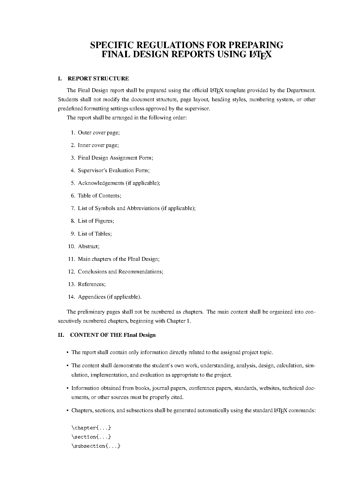

# LaTeX-DATN

[](https://github.com/Ex6TenZ13/LaTeX-DATN/actions/workflows/latex.yml)

[English version](#english)

> 📣 **Mẫu LaTeX DATN đang trong quá trình chỉnh sửa và hoàn thiện**
>
> Nội dung, cấu trúc và định dạng trong các tệp `.tex` có thể thay đổi; PDF và ảnh xem trước sẽ được cập nhật theo. Nếu đang sử dụng mẫu, hãy kiểm tra [bản phát hành mới nhất](https://github.com/Ex6TenZ13/LaTeX-DATN/releases/latest) trước khi bắt đầu hoặc tiếp tục báo cáo.
>
> Có ý tưởng hoặc phát hiện lỗi? Hãy gửi góp ý tại [Issues](https://github.com/Ex6TenZ13/LaTeX-DATN/issues). Vui lòng nêu tệp hoặc phần liên quan, đề xuất hoặc vấn đề, và ảnh minh họa nếu phù hợp.

Mẫu báo cáo đồ án tốt nghiệp bằng LaTeX.

[](https://github.com/Ex6TenZ13/LaTeX-DATN/blob/main/Quyen_DATN.pdf)

Bấm vào ảnh để mở PDF trong trình xem của GitHub. Bản phát hành mới nhất chỉ có gói ZIP mã nguồn để tải tại [GitHub Releases](https://github.com/Ex6TenZ13/LaTeX-DATN/releases/latest); PDF được xem riêng qua ảnh xem trước.

ZIP không bao gồm `README.md`; gói chỉ gồm `Quyen_DATN.tex`, `References.bib`, `Regulations.tex` và thư mục `figures/`.

## Tải và sử dụng gói ZIP

1. Tải [gói ZIP của bản phát hành mới nhất](https://github.com/Ex6TenZ13/LaTeX-DATN/releases/latest/download/LaTeX-DATN.zip) từ mục **Assets** trong trang Releases.
2. Giải nén ZIP vào một thư mục trên máy tính; không mở hoặc biên dịch tệp `.tex` trực tiếp bên trong ZIP. Giữ nguyên cấu trúc thư mục và các tệp đi kèm.
3. Mở TeXstudio, dùng **File → Open** để đi tới thư mục vừa giải nén và mở `Quyen_DATN.tex`. TeXstudio sẽ hiển thị các tệp cùng thư mục trong **File Explorer**; chọn **Build & View** hoặc nhấn `F5` để biên dịch và xem PDF.

Gói ZIP chứa mã nguồn và tài nguyên của mẫu, không phải file PDF đã biên dịch. Nếu TeXstudio/MiKTeX hỏi cài package còn thiếu, hãy cho phép cài đặt rồi biên dịch lại.

## Cài đặt trên Windows

### 1. MiKTeX

1. Tải **Basic MiKTeX Installer** từ [trang cài đặt chính thức](https://miktex.org/howto/install-miktex).
2. Cài cho người dùng hiện tại, chọn khổ giấy A4 và cho phép tự động cài các gói còn thiếu.
3. Mở **MiKTeX Console**, chọn **Updates** và cài toàn bộ bản cập nhật trước khi biên dịch.

### 2. TeXstudio

1. Tải và cài [TeXstudio](https://texstudio.org/).
2. Mở `Quyen_DATN.tex`.
3. Trong **Options → Configure TeXstudio → Build**, chọn trình biên dịch mặc định là **PdfLaTeX**; nhấn **Build & View** hoặc `F5`.

### 3. SumatraPDF

Tải [SumatraPDF](https://www.sumatrapdfreader.org/download-free-pdf-viewer) để xem PDF và đồng bộ vị trí giữa mã nguồn với tài liệu. Trong TeXstudio, chọn **Options → Configure TeXstudio → Commands → External PDF Viewer** rồi nhập:

```text
"C:/Program Files/SumatraPDF/SumatraPDF.exe" -reuse-instance -forward-search "?c:am.tex" @ "?am.pdf"
```

Để tìm ngược từ PDF về mã nguồn, mở **Settings → Options** của SumatraPDF và đặt lệnh inverse search theo [hướng dẫn tích hợp LaTeX](https://www.sumatrapdfreader.org/docs/LaTeX-integration):

```text
"C:\Program Files\TeXstudio\texstudio.exe" "%f" -line %l
```
---

## English

### Update notice

> 📣 **The LaTeX-DATN template is being revised and finalized.**
>
> The content, structure, and formatting of the `.tex` files may change. The PDF and preview image will be updated accordingly. If you are using this template, check the [latest release](https://github.com/Ex6TenZ13/LaTeX-DATN/releases/latest) before starting or continuing your report.
>
> Have an idea or found an issue? Please share it via [Issues](https://github.com/Ex6TenZ13/LaTeX-DATN/issues). Include the relevant file or section, your suggestion or a description of the problem, and a screenshot if helpful.

This is a LaTeX template for a graduation thesis report.

### PDF preview and releases

Click the preview image above to open the PDF in GitHub's viewer. The latest release offers one downloadable ZIP package on [GitHub Releases](https://github.com/Ex6TenZ13/LaTeX-DATN/releases/latest); the PDF is viewed separately through the preview.

The ZIP does not include `README.md`; it contains only `Quyen_DATN.tex`, `References.bib`, `Regulations.tex`, and the `figures/` folder.

### Download and use the ZIP package

1. Download the [latest ZIP package](https://github.com/Ex6TenZ13/LaTeX-DATN/releases/latest/download/LaTeX-DATN.zip) from the **Assets** section of the Releases page.
2. Extract the ZIP archive to a folder on your computer. Do not open or compile the `.tex` file directly from inside the archive. Keep the folder structure and accompanying files unchanged.
3. In TeXstudio, choose **File → Open**, navigate to the extracted folder, and open `Quyen_DATN.tex`. TeXstudio's **File Explorer** shows the other files in the same folder. Select **Build & View** or press `F5` to compile the document and view the PDF.

The ZIP package contains the template's source files and resources, not the compiled PDF. If TeXstudio/MiKTeX asks to install missing packages, allow the installation and compile again.

### Installing on Windows

#### 1. MiKTeX

1. Download the **Basic MiKTeX Installer** from the [official installation page](https://miktex.org/howto/install-miktex).
2. Install it for the current user, select A4 paper, and allow MiKTeX to install missing packages automatically.
3. Open **MiKTeX Console**, select **Updates**, and install all updates before compiling.

#### 2. TeXstudio

1. Download and install [TeXstudio](https://texstudio.org/).
2. Open `Quyen_DATN.tex`.
3. In **Options → Configure TeXstudio → Build**, set **PdfLaTeX** as the default compiler. Select **Build & View** or press `F5`.

#### 3. SumatraPDF

Download [SumatraPDF](https://www.sumatrapdfreader.org/download-free-pdf-viewer) to view PDFs and synchronize positions between the source and document. In TeXstudio, choose **Options → Configure TeXstudio → Commands → External PDF Viewer** and enter:

```text
"C:/Program Files/SumatraPDF/SumatraPDF.exe" -reuse-instance -forward-search "?c:am.tex" @ "?am.pdf"
```

For inverse search from the PDF back to the source, open **Settings → Options** in SumatraPDF and set the inverse-search command according to the [LaTeX integration guide](https://www.sumatrapdfreader.org/docs/LaTeX-integration):

```text
"C:\Program Files\TeXstudio\texstudio.exe" "%f" -line %l
```
